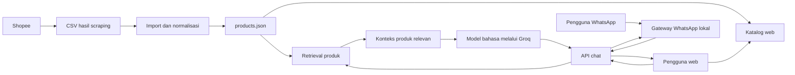

# Maternal Disaster — Katalog RAG Web & WhatsApp

> Katalog produk berbasis web dengan chatbot Retrieval-Augmented Generation (RAG) dan integrasi WhatsApp.

## Identitas

| Keterangan | Isi |
|---|---|
| Nama | Ihtada Haqi Prasetyo |
| NIM | `102062400060` |
| Kelas | `IS-06-01` |
| Mata kuliah | Kecerdasan Artifisial dan Penerapannya |
| Dosen pengampu | M. Nizar P. Ma’ady, S.Kom., M.IM., M.Kom. |
| Semester | Ganjil 2026–2027 |
| Tanggal praktikum | 11 November 2026 |
| URL website | [maternal-disaster-rag.vercel.app](https://maternal-disaster-rag.vercel.app/) |
| Repositori | [github.com/Tyoo99/maternal-disaster-rag](https://github.com/Tyoo99/maternal-disaster-rag) |

## Ringkasan

Proyek ini membangun website katalog berdasarkan **290 produk Maternal Disaster Official Shop** yang diperoleh dari lapak resmi di Shopee Indonesia. Data hasil scraping dinormalisasi menjadi JSON dan CSV, kemudian digunakan sebagai satu sumber informasi untuk katalog web, chatbot RAG, dan bot WhatsApp.

Chatbot menggunakan pencarian produk lokal untuk mengambil data yang relevan berdasarkan nama, kategori, rentang harga, rating, serta kata kunci pengguna. Data tersebut diberikan sebagai konteks kepada model bahasa melalui Groq. Pendekatan ini membuat jawaban chatbot lebih terarah dan mengurangi kemungkinan model mengarang informasi produk.

## 1. Pendahuluan

### 1.1 Latar belakang

Katalog marketplace biasanya memuat banyak produk sehingga pengguna perlu melakukan pencarian, penyaringan, dan perbandingan secara manual. Chatbot dapat menyederhanakan proses tersebut melalui pertanyaan alami seperti “ada jaket di bawah 700 ribu?” atau “aksesori termurah apa?”. Namun, model bahasa tanpa konteks khusus berisiko memberikan harga atau detail produk yang tidak sesuai.

Untuk mengatasi masalah tersebut, proyek ini menerapkan RAG. Sistem terlebih dahulu mencari produk yang sesuai dari data hasil scraping, lalu hanya mengirimkan produk relevan sebagai konteks kepada model AI. Website dan WhatsApp menggunakan sumber data serta layanan chatbot yang sama agar informasi yang diberikan konsisten.

### 1.2 Rumusan masalah

1. Bagaimana menampilkan data hasil scraping Shopee sebagai katalog yang mudah dicari dan disaring?
2. Bagaimana membuat chatbot menjawab berdasarkan data produk yang tersedia?
3. Bagaimana menyediakan chatbot yang sama melalui website dan WhatsApp?
4. Bagaimana menjalankan website pada platform serverless sementara gateway WhatsApp memerlukan proses browser yang aktif terus-menerus?

### 1.3 Tujuan

- Menyediakan katalog web untuk 290 produk Maternal Disaster.
- Mendukung pencarian, filter kategori, pengurutan harga, dan pengurutan rating.
- Membuat chatbot Bahasa Indonesia yang menggunakan konteks katalog.
- Menghubungkan layanan chatbot dengan WhatsApp.
- Menyediakan deployment website publik melalui Vercel.
- Menguji retrieval, konteks percakapan, dan respons sistem secara otomatis.

### 1.4 Manfaat

Sistem membantu pengguna menemukan produk dengan pertanyaan alami, mempercepat perbandingan produk, dan menyediakan akses melalui dua kanal. Bagi pengembang, proyek ini menjadi contoh integrasi pengolahan data, REST API, RAG, model bahasa, antarmuka web, dan otomasi WhatsApp.

## 2. Sumber dan Pengolahan Data

Sumber data berasal dari [Maternal Disaster Official Shop](https://shopee.co.id/maternaldisasterofficial) di Shopee Indonesia. Dataset berisi nama produk, kategori, harga, rating, badge, highlight, gambar, dan tautan produk.

### 2.1 Berkas data

| Berkas | Fungsi |
|---|---|
| `data/shopee-raw.csv` | Data asli hasil scraping. |
| `data/products.csv` | Data tabular dengan nama kolom yang telah dirapikan. |
| `data/products.json` | Sumber data utama untuk website dan RAG. |
| `scripts/import-shopee.js` | Normalisasi ulang data CSV menjadi format aplikasi. |

Proses impor dapat dijalankan dengan:

```bash
npm run import:shopee
```

### 2.2 Statistik dataset

| Kategori | Jumlah produk |
|---|---:|
| T-Shirt | 86 |
| Accessories | 57 |
| Pants | 27 |
| Sweatshirt | 26 |
| Footwear | 25 |
| Bags | 22 |
| Jacket | 17 |
| Button-Up | 15 |
| Headwear | 9 |
| Underwear | 6 |
| **Total** | **290** |

Rentang harga pada dataset adalah **Rp49.000 sampai Rp2.599.000**. Harga dan ketersediaan di marketplace dapat berubah, sehingga pengguna tetap diarahkan ke halaman Shopee untuk verifikasi akhir dan transaksi.

## 3. Teknologi yang Digunakan

| Teknologi | Kegunaan |
|---|---|
| Node.js 20+ | Runtime aplikasi. |
| Express 5 | Server HTTP dan REST API. |
| HTML, CSS, JavaScript | Antarmuka katalog dan konsol WhatsApp. |
| Groq SDK | Akses model utama `qwen/qwen3.8-27b` dan model fallback. |
| `whatsapp-web.js` | Integrasi pesan WhatsApp Web. |
| Puppeteer/Chromium | Browser otomatis untuk gateway WhatsApp. |
| Vercel | Hosting website dan serverless API. |
| Node Test Runner | Pengujian retrieval dan chatbot. |

## 4. Arsitektur Sistem



Website publik dan serverless API dijalankan di Vercel. Gateway WhatsApp dijalankan pada komputer lokal karena membutuhkan Chromium dan koneksi sesi yang aktif terus-menerus. Keduanya menggunakan struktur data produk yang sama.

## 5. Metode Retrieval-Augmented Generation

Alur chatbot terdiri dari langkah berikut:

1. Pesan pengguna diterima dari website atau WhatsApp.
2. Sistem memeriksa apakah pesan berupa sapaan, ucapan terima kasih, atau FAQ sederhana.
3. Pertanyaan produk dinormalisasi menjadi huruf kecil dan token pencarian.
4. Sistem mengenali alias kategori Bahasa Indonesia, misalnya “kaos” menjadi `T-Shirt`, “tas” menjadi `Bags`, dan “aksesori” menjadi `Accessories`.
5. Sistem mendeteksi filter harga seperti “di bawah 700 ribu”, “minimal 500 ribu”, atau rentang harga.
6. Kandidat produk diberi skor berdasarkan kecocokan nama, kategori, badge, dan highlight.
7. Produk dapat diurutkan berdasarkan relevansi, harga termurah, harga termahal, atau rating.
8. Maksimal delapan produk relevan disusun menjadi konteks yang berisi nama, kategori, harga, rating, highlight, dan URL.
9. Konteks, riwayat percakapan, dan pertanyaan dikirim ke model Groq.
10. Jawaban dikembalikan kepada pengguna melalui kanal asal.

Prompt sistem membatasi model agar hanya menggunakan fakta pada konteks katalog. Model juga diperintahkan untuk tidak mengarang stok, ukuran, bahan, diskon, atau detail lain yang tidak tersedia.

### 5.1 Konteks percakapan

Riwayat percakapan disimpan per pengguna di memori. Konfigurasi bawaan mengirim delapan pesan terbaru ke model dan menyimpan maksimal sepuluh pesan. Jika pertanyaan lanjutan seperti “berapa harganya?” tidak menghasilkan retrieval langsung, sistem menggabungkannya dengan pertanyaan pengguna sebelumnya.

### 5.2 Model utama dan fallback

Konfigurasi contoh menggunakan `qwen/qwen3.8-27b` sebagai model utama dan `openai/gpt-oss-20b` sebagai fallback. Jika model utama gagal, layanan mencoba model lain yang tercantum pada `GROQ_FALLBACK_MODELS`. Sistem memberikan pesan khusus ketika kuota habis atau layanan AI tidak tersedia.

## 6. Fitur Aplikasi

### 6.1 Katalog web

- Menampilkan kartu produk dari dataset.
- Mencari produk berdasarkan beberapa kata kunci.
- Memfilter berdasarkan kategori.
- Mengurutkan produk berdasarkan harga dan rating.
- Menggunakan paginasi atau pemuatan data bertahap.
- Membuka tautan produk resmi di Shopee.
- Menampilkan tombol WhatsApp jika nomor publik dikonfigurasi.

### 6.2 Chatbot web

- Menjawab sapaan dan FAQ.
- Memberikan rekomendasi berdasarkan kategori dan anggaran.
- Menjawab pertanyaan produk spesifik.
- Mempertahankan konteks untuk pertanyaan lanjutan.
- Membatasi pesan maksimal 500 karakter.
- Menerapkan rate limit 20 pesan per menit per alamat IP.

### 6.3 Gateway WhatsApp

- Menampilkan QR untuk menghubungkan akun WhatsApp.
- Menampilkan status inisialisasi dan nomor bot.
- Menerima pesan pribadi dan mengabaikan grup, status, serta pesan dari bot sendiri.
- Mengirim respons dari layanan chatbot yang sama.
- Mendukung start, stop, dan reset sesi melalui halaman admin.
- Menangani folder sesi Chromium yang terkunci agar server tidak crash.

## 7. Struktur Proyek

```text
chatbot-rag/
├── api/                    # Entry point API untuk Vercel
├── data/                   # Dataset mentah dan hasil normalisasi
├── lib/
│   ├── chatbot.js          # Orkestrasi FAQ, RAG, Groq, dan riwayat
│   ├── config.js           # Konfigurasi environment
│   ├── rag.js              # Retrieval dan penyusunan konteks
│   ├── register-api.js     # REST API aplikasi
│   └── resilient-local-auth.js
├── public/                 # Antarmuka website dan halaman admin
├── scripts/                # Script impor dataset
├── test/                   # Pengujian otomatis
├── app.js                  # Aplikasi Express untuk web/serverless
├── server-v2.js            # Server lokal dan gateway WhatsApp
├── knowledge.json          # Respons FAQ
└── vercel.json             # Konfigurasi deployment
```

## 8. REST API

| Method | Endpoint | Fungsi |
|---|---|---|
| `GET` | `/api/health` | Memeriksa status API dan jumlah produk. |
| `GET` | `/api/store` | Mengambil profil toko dan kategori. |
| `GET` | `/api/products` | Mengambil, mencari, memfilter, dan mengurutkan produk. |
| `GET` | `/api/knowledge` | Mengambil data FAQ. |
| `GET` | `/api/groq/quota` | Melihat model dan informasi kuota terakhir. |
| `POST` | `/api/chat` | Mengirim pesan kepada chatbot. |
| `GET` | `/api/bot/status` | Melihat status gateway WhatsApp lokal. |
| `GET` | `/api/bot/qr` | Mengambil QR WhatsApp aktif. |
| `POST` | `/api/bot/start` | Memulai gateway WhatsApp. |
| `POST` | `/api/bot/stop` | Menghentikan gateway WhatsApp. |
| `POST` | `/api/bot/reset` | Menghapus sesi WhatsApp lokal. |

Contoh pencarian produk:

```http
GET /api/products?q=jacket&sort=price-asc&page=1&limit=12
```

Contoh permintaan chatbot:

```json
{
  "userId": "pengguna-demo",
  "message": "Ada jaket di bawah 700 ribu?"
}
```

## 9. Instalasi dan Konfigurasi

### 9.1 Persyaratan

- Node.js versi 20 atau lebih baru.
- Akun dan API key Groq.
- Koneksi internet.
- Akun WhatsApp untuk pengujian gateway lokal.

### 9.2 Instalasi

```bash
npm install
```

Salin `.env.example` menjadi `.env`, kemudian isi konfigurasi berikut:

```dotenv
GROQ_API_KEY=isi_api_key_groq
GROQ_MODEL=qwen/qwen3.8-27b
GROQ_FALLBACK_MODELS=openai/gpt-oss-20b
GROQ_MAX_TOKENS=1000
GROQ_TEMPERATURE=0.25
GROQ_HISTORY_INPUT_MESSAGES=8
GROQ_HISTORY_STORED_MESSAGES=10
RAG_TOP_K=8

PUBLIC_WHATSAPP_NUMBER=6281234567890
PUBLIC_SITE_URL=https://maternal-disaster-rag.vercel.app

PORT=3001
AUTO_START_BOT=false
WA_CLIENT_ID=maternal-disaster-rag
WA_HEADLESS=true
WA_AUTH_TIMEOUT_MS=45000
```

Jangan mengunggah `.env` karena berisi API key. File tersebut sudah dikecualikan melalui `.gitignore` dan `.vercelignore`.

### 9.3 Menjalankan aplikasi

Mode pengembangan:

```bash
npm run dev
```

Mode biasa:

```bash
npm start
```

Alamat lokal:

- Website: <http://localhost:3001>
- Konsol WhatsApp: <http://localhost:3001/admin.html>

Pada penggunaan pertama, buka konsol WhatsApp, tekan tombol mulai, lalu pindai kode QR melalui menu **Perangkat tertaut** pada aplikasi WhatsApp.

## 10. Deployment Vercel

1. Push proyek ke repository GitHub.
2. Buka Vercel dan pilih **Add New Project**.
3. Import repository proyek.
4. Gunakan framework preset hasil deteksi otomatis dan kosongkan Build Command.
5. Tambahkan variabel lingkungan `GROQ_API_KEY`, `GROQ_MODEL`, `GROQ_FALLBACK_MODELS`, `GROQ_MAX_TOKENS`, `GROQ_TEMPERATURE`, `GROQ_HISTORY_INPUT_MESSAGES`, `GROQ_HISTORY_STORED_MESSAGES`, `RAG_TOP_K`, `PUBLIC_WHATSAPP_NUMBER`, dan `PUBLIC_SITE_URL`.
6. Jalankan deployment dan uji endpoint `/api/health`.

Folder `api/` digunakan sebagai Vercel Functions dan folder `public/` disajikan sebagai aset statis. Gateway WhatsApp tidak dijalankan di Vercel karena membutuhkan Chromium serta proses persisten; gateway tetap dijalankan dari `server-v2.js` pada komputer lokal.

## 11. Pengujian

Pengujian otomatis dijalankan dengan:

```bash
npm test
```

Saat laporan ini disusun, seluruh **8 pengujian** berhasil. Pengujian meliputi pemuatan 290 produk, sapaan tanpa retrieval, alias kategori, filter anggaran, pencarian produk spesifik, pengurutan termurah, kelengkapan konteks dan tautan, serta pertanyaan lanjutan menggunakan riwayat.

### 11.1 Skenario pengujian fungsional

| No. | Input atau tindakan | Hasil yang diharapkan |
|---:|---|---|
| 1 | `halo` | Bot membalas sapaan tanpa rekomendasi produk acak. |
| 2 | `ada jaket di bawah 700 ribu?` | Produk berkategori jacket dengan harga maksimal Rp700.000. |
| 3 | `aksesori termurah` | Produk Accessories diurutkan dari harga terendah. |
| 4 | `berapa harga acc flair?` | Produk spesifik muncul beserta harga dan tautannya. |
| 5 | `berapa harganya?` setelah pertanyaan produk | Bot menggunakan konteks percakapan sebelumnya. |
| 6 | Filter dan sort pada katalog | Daftar produk berubah sesuai pilihan pengguna. |
| 7 | Memindai kode QR WhatsApp | Status gateway berubah menjadi siap. |
| 8 | Pesan WhatsApp pribadi | Bot mengirim jawaban yang sesuai katalog. |

## 12. Kendala dan Penyelesaian

### 12.1 Folder sesi WhatsApp terkunci

Pada Windows, Chromium dapat mengunci `lockfile` pada folder `.wwebjs_auth`. Penghapusan sesi ketika browser masih aktif menghasilkan error `EBUSY` dan dapat menghentikan server. Solusinya adalah strategi autentikasi lokal yang melakukan retry, menangani error lock Windows, dan menyediakan reset sesi setelah browser berhenti.

### 12.2 QR lama muncul atau inisialisasi timeout

Cache HTML WhatsApp Web dapat tidak cocok dengan aset terbaru. Selain itu, WhatsApp dapat mendeteksi Chromium headless sebagai browser yang tidak didukung jika metadata browser tidak lengkap. Solusi yang diterapkan adalah memuat halaman WhatsApp Web tanpa memaksa cache HTML, mengirim metadata Chrome/Windows yang sesuai, dan menyediakan timeout yang dapat dikonfigurasi.

### 12.3 Risiko halusinasi model

Model bahasa dapat menghasilkan detail yang tidak tersedia. Sistem mengurangi risiko ini dengan retrieval lokal, konteks produk terstruktur, prompt sistem yang membatasi sumber fakta, serta arahan untuk melakukan verifikasi harga dan ketersediaan di Shopee.

## 13. Keamanan dan Batasan

- API key hanya disimpan pada variabel lingkungan.
- Endpoint chat membatasi panjang pesan dan jumlah permintaan.
- Bot mengabaikan pesan grup, status, dan pesan yang dikirim oleh akun bot sendiri.
- Data stok, variasi ukuran, dan harga real-time tidak tersedia jika tidak terdapat pada hasil scraping.
- Riwayat percakapan hanya disimpan di memori dan akan hilang ketika server restart.
- Perubahan struktur internal WhatsApp Web dapat memerlukan pembaruan `whatsapp-web.js`.
- Integrasi WhatsApp berbasis WhatsApp Web tidak menggantikan WhatsApp Business Platform resmi untuk penggunaan produksi berskala besar.

## 14. Kesimpulan

Proyek berhasil mengolah 290 produk hasil scraping menjadi katalog web, layanan chatbot RAG, dan bot WhatsApp. Retrieval lokal memungkinkan sistem memahami kategori, batas harga, produk spesifik, pengurutan, dan pertanyaan lanjutan. Groq digunakan untuk menyusun jawaban alami berdasarkan konteks tersebut, sedangkan tautan produk Shopee tetap disertakan untuk verifikasi.

Arsitektur memisahkan website serverless dari gateway WhatsApp lokal sehingga setiap komponen dijalankan pada lingkungan yang sesuai. Pengujian otomatis menunjukkan fungsi retrieval utama bekerja sesuai skenario. Pengembangan selanjutnya dapat menambahkan sinkronisasi data berkala, penyimpanan riwayat ke database, autentikasi halaman admin, dan penggunaan API WhatsApp resmi.

## 15. Referensi

1. Maternal Disaster Official Shop: <https://shopee.co.id/maternaldisasterofficial>
2. Dokumentasi Node.js: <https://nodejs.org/docs/latest/api/>
3. Dokumentasi Express: <https://expressjs.com/>
4. Dokumentasi model Qwen 3.8 27B di Groq: <https://console.groq.com/docs/model/qwen/qwen3.8-27b>
5. Dokumentasi `whatsapp-web.js`: <https://wwebjs.dev/>
6. Dokumentasi Vercel: <https://vercel.com/docs>
