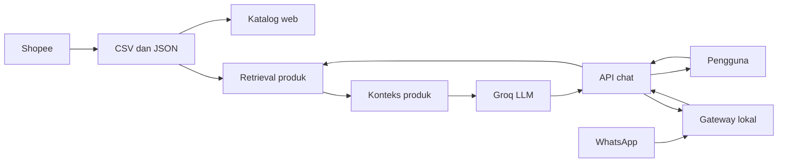

# Maternal Disaster — Katalog RAG Web & WhatsApp

Katalog web untuk 290 produk Maternal Disaster Official Shop dengan pencarian produk, chatbot Retrieval-Augmented Generation (RAG), dan gateway WhatsApp lokal.

Demo: [maternal-disaster-rag.vercel.app](https://maternal-disaster-rag.vercel.app/)

## Ringkasan

Data produk hasil scraping dinormalisasi ke CSV dan JSON, lalu digunakan sebagai sumber yang sama oleh katalog web dan chatbot. Ketika pengguna mengirim pertanyaan, sistem mencari produk yang relevan berdasarkan nama, kategori, harga, rating, dan kata kunci. Hasil retrieval disusun sebagai konteks untuk model Groq agar jawaban tetap berdasarkan katalog.

Website dan API dapat dijalankan di Vercel. Gateway WhatsApp dijalankan secara lokal karena membutuhkan Chromium dan sesi browser yang terus aktif.

## Fitur Utama

- Katalog berisi 290 produk dari satu lapak Shopee.
- Pencarian, filter kategori, paginasi, dan pengurutan harga atau rating.
- Retrieval produk berdasarkan kategori, kata kunci, dan batas harga.
- Rekomendasi menggunakan RAG dan Groq.
- Riwayat percakapan untuk memahami pertanyaan lanjutan.
- Jawaban langsung untuk sapaan, ucapan terima kasih, dan FAQ sederhana.
- Chatbot web dan gateway WhatsApp menggunakan sumber data yang sama.
- Fallback model ketika model utama tidak tersedia.
- Pembatasan panjang pesan dan jumlah permintaan ke endpoint chat.
- Pengujian otomatis untuk fungsi retrieval dan konteks percakapan.

## Arsitektur Singkat



## Teknologi

- Node.js 20+
- Express 5
- HTML, CSS, dan JavaScript
- Groq SDK
- `whatsapp-web.js`
- Puppeteer dan Chromium
- Vercel Functions
- Node.js Test Runner

## Struktur Proyek

```text
chatbot-rag/
├── api/                    # Entry point Vercel Functions
├── data/                   # Dataset mentah dan hasil normalisasi
├── lib/                    # Konfigurasi, RAG, chatbot, dan REST API
├── public/                 # Katalog web dan konsol WhatsApp
├── scripts/                # Proses impor dataset
├── test/                   # Pengujian otomatis
├── app.js                  # Aplikasi Express
├── server-v2.js            # Server lokal dan gateway WhatsApp
├── knowledge.json          # Data FAQ
└── vercel.json             # Konfigurasi Vercel
```

## Menjalankan Secara Lokal

### Persyaratan

- Node.js versi 20 atau lebih baru
- API key Groq
- Akun WhatsApp jika ingin menguji gateway lokal

### Instalasi

```bash
npm install
```

Salin `.env.example` menjadi `.env`, lalu isi `GROQ_API_KEY` dan konfigurasi publik yang diperlukan. Konfigurasi model bawaan:

```dotenv
GROQ_MODEL=qwen/qwen3.8-27b
GROQ_FALLBACK_MODELS=openai/gpt-oss-20b
```

Jangan mengunggah `.env` karena berisi kredensial. File tersebut telah dikecualikan melalui `.gitignore` dan `.vercelignore`.

### Menjalankan aplikasi

```bash
npm run dev
```

Alamat lokal:

- Katalog: <http://localhost:3001>
- Konsol WhatsApp: <http://localhost:3001/admin.html>

Untuk mengaktifkan gateway, buka konsol WhatsApp, pilih **Mulai Bot**, lalu pindai kode QR melalui menu **Perangkat tertaut** pada WhatsApp.

## Perintah yang Tersedia

| Perintah | Fungsi |
|---|---|
| `npm run dev` | Menjalankan server dengan `nodemon`. |
| `npm start` | Menjalankan server secara normal. |
| `npm test` | Menjalankan pengujian otomatis. |
| `npm run import:shopee` | Menormalisasi ulang dataset mentah. |

## API Utama

| Method | Endpoint | Fungsi |
|---|---|---|
| `GET` | `/api/health` | Status API dan jumlah produk. |
| `GET` | `/api/store` | Profil toko dan daftar kategori. |
| `GET` | `/api/products` | Pencarian, filter, dan pengurutan produk. |
| `GET` | `/api/knowledge` | Data FAQ. |
| `GET` | `/api/groq/quota` | Model aktif dan informasi kuota terakhir. |
| `POST` | `/api/chat` | Mengirim pesan ke chatbot. |
| `GET` | `/api/bot/status` | Status gateway WhatsApp lokal. |
| `POST` | `/api/bot/start` | Memulai gateway WhatsApp. |
| `POST` | `/api/bot/stop` | Menghentikan gateway WhatsApp. |
| `POST` | `/api/bot/reset` | Mereset sesi WhatsApp lokal. |

Contoh permintaan chatbot:

```json
{
  "userId": "pengguna-demo",
  "message": "Ada jaket di bawah 700 ribu?"
}
```

## Pengujian

```bash
npm test
```

Pengujian mencakup pemuatan dataset, sapaan tanpa retrieval, alias kategori, filter anggaran, pencarian produk spesifik, pengurutan harga, kelengkapan konteks, dan pertanyaan lanjutan.

## Deployment

Folder `api/` dijalankan sebagai Vercel Functions dan folder `public/` disajikan sebagai aset statis. Tambahkan variabel Groq dan konfigurasi publik dari `.env.example` ke pengaturan environment Vercel.

Gateway WhatsApp tidak dijalankan di Vercel. Komponen tersebut tetap dijalankan melalui `server-v2.js` pada komputer lokal karena membutuhkan Chromium dan proses persisten.

## Batasan

- Harga dan ketersediaan produk dapat berubah; tautan Shopee tetap menjadi sumber verifikasi akhir.
- Riwayat percakapan disimpan di memori dan hilang ketika server dimulai ulang.
- Data stok, ukuran, bahan, dan diskon hanya digunakan jika tersedia pada dataset.
- Integrasi WhatsApp Web ditujukan untuk demonstrasi, bukan pengganti WhatsApp Business Platform untuk penggunaan produksi.
